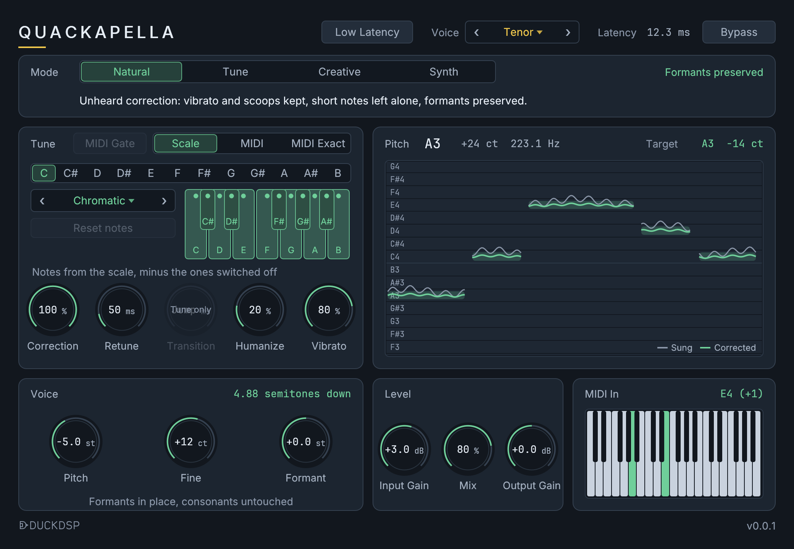
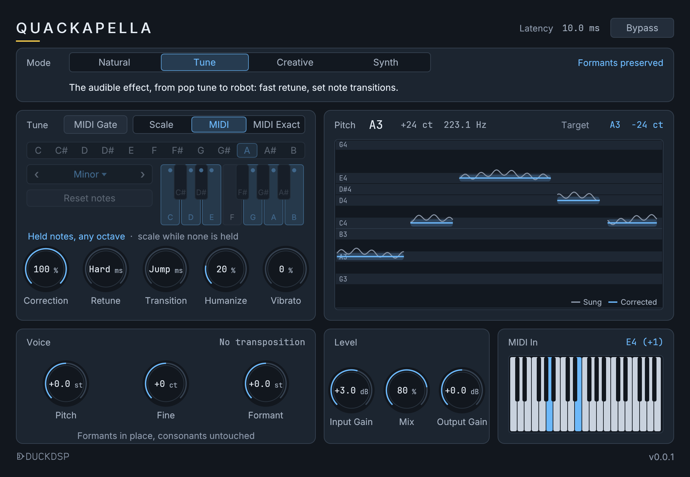
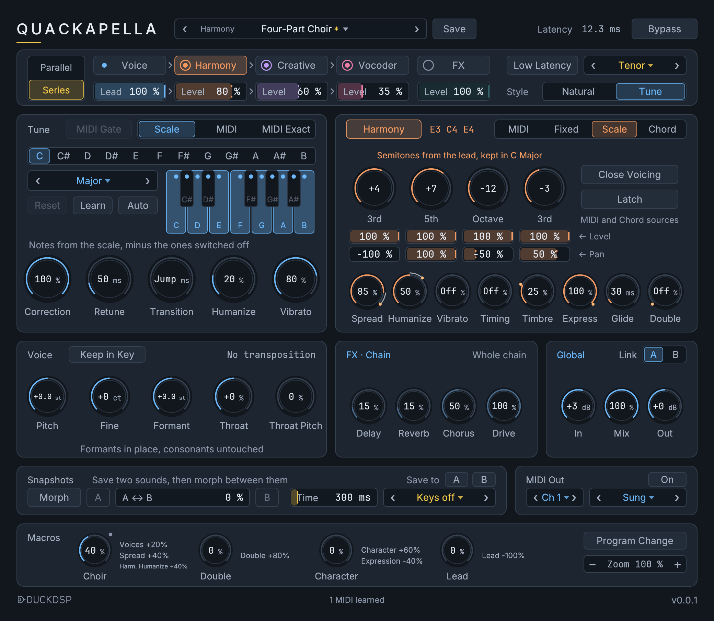
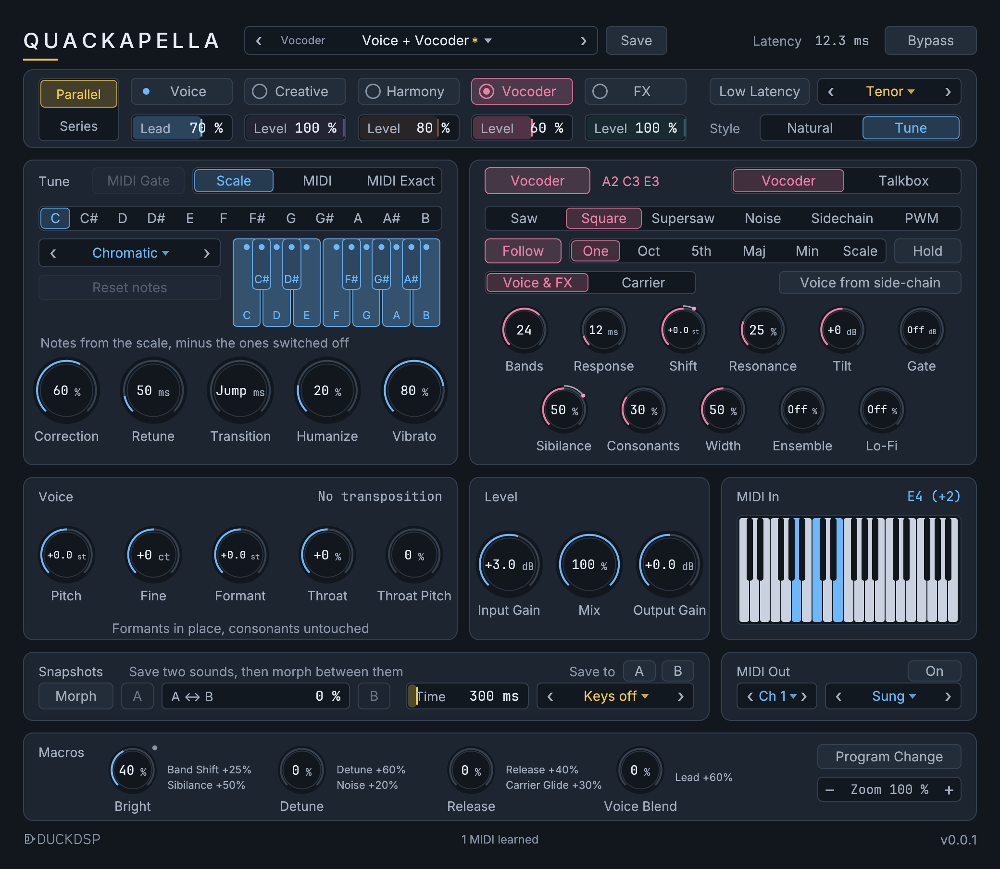
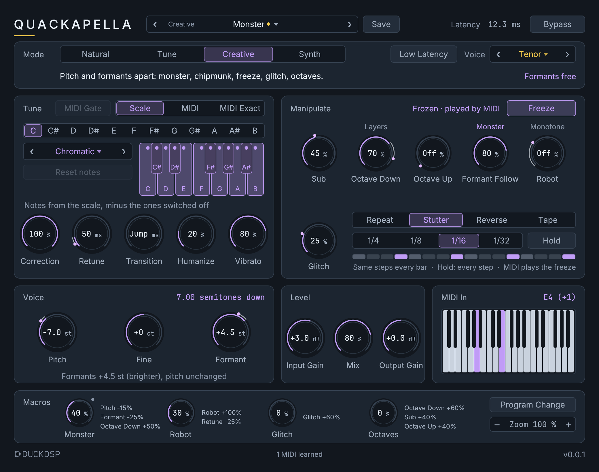
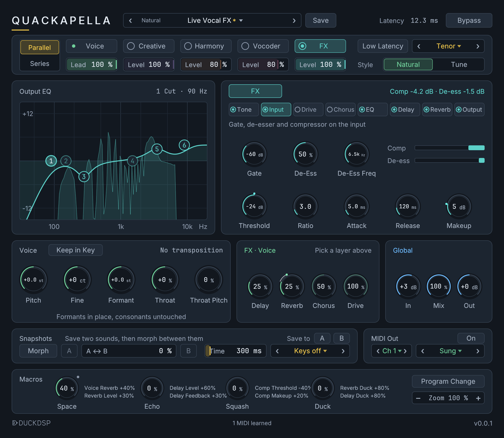
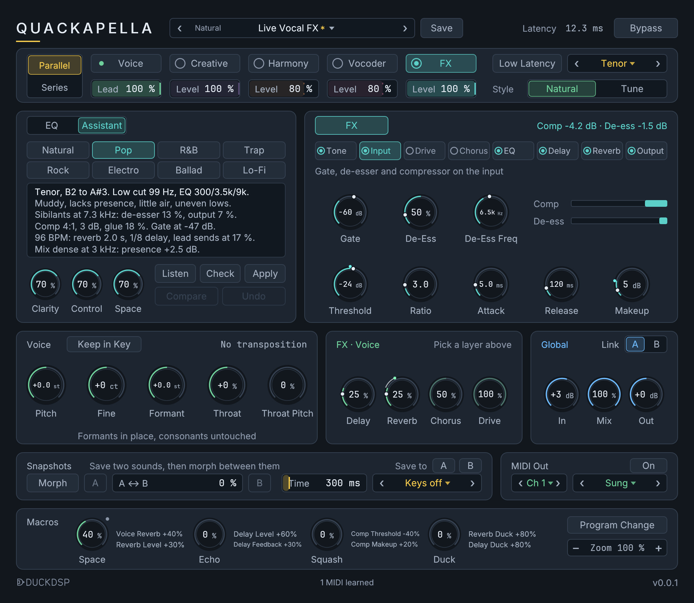
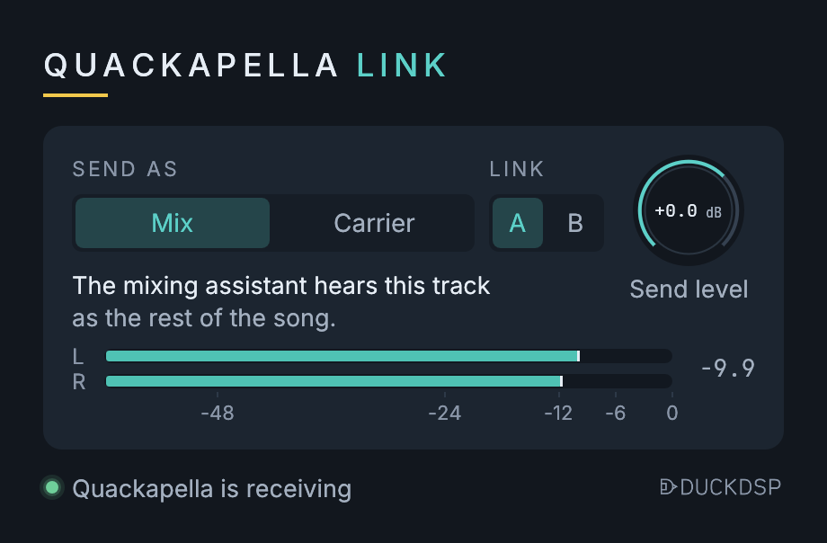

# Quackapella

**Real-time vocal manipulation for live use, by DuckDSP.**

Quackapella is an open-source audio plugin written in Rust. It brings
together, in one low-latency plugin built for the stage, pitch
correction (from transparent to hard-tune), Manipulator-style voice
bending (pitch and formants apart, octaves, freeze, glitch) and
VocalSynth-style synthesis (MIDI-played harmonies, vocoder, talkbox).

Its core is a **Natural mode** that corrects or transposes a voice, even
by large intervals, without sounding processed: formants stay in place,
consonants and breath are left untouched, correction is humanized.



- **Formats:** AU v2 (Logic Pro, GarageBand), VST3 and CLAP, on macOS
  (Apple Silicon and Intel).
- **Companion plugin:** Quackapella Link, installed with it.
- **License:** GPL-3.0-or-later, free, no account, no copy protection.

## Features

| | |
|---|---|
| **Natural** | Pitch-synchronous resynthesis (PSOLA family) guided by a YIN pitch detector, spectral envelope kept in place, unvoiced sounds passed through. Correct or transpose without the "phasy" or chipmunk sound. |
| **Tune** | Classic pitch correction: scales, key detection (Learn / Auto), notes forced from MIDI, retune speed, transition time, humanize, vibrato kept. From discreet to hard-tune. |
| **Creative** | Pitch and formant shift apart (monster, chipmunk), octave layers, freeze played from MIDI, robot, tempo-synced glitch (repeat, reverse, stutter, tape stop). |
| **Synth** | Harmonizer on the grains of the voice (in-key intervals, polyphonic MIDI, MIDI chords, humanize, stereo spread), vocoder and talkbox with an internal carrier or a side-chain one, whisper layer. |
| **Layers and chain** | Voice, harmonies, vocoder and creative layers mixed in parallel, each with level and solo, or chained in series. |
| **FX** | Tone, Drive (5 styles), chorus, tempo-synced delay with ducking, reverb, output EQ with dynamic bands and exciter, output dynamics, per-layer sends. |
| **Mix assistant** | Listens to the voice (and the rest of the song through Link) and suggests EQ, dynamics and space for a chosen style. Plain signal analysis, no machine learning. |
| **Presets and control** | 62 factory presets, by module and by style (Pop, R&B, Trap, Electro, Choir, Robot, Cinematic, Lo-Fi), A/B snapshots and morphing, macros, MIDI learn, MIDI out of the sung notes. |

| | |
|---|---|
|  |  |
|  |  |
|  |  |

### Quackapella Link

A second, tiny plugin to put on another track. It passes its audio
through untouched (zero latency) and sends a copy to Quackapella, with no
side-chain routing to set up: either the rest of the song for the mix
assistant (*Mix*), or a synth for the vocoder (*Carrier*).



## Latency

Quackapella is meant for live singing. Everything is computed sample by
sample, so the host buffer size (32 or 64 samples is fine) adds nothing.
The latency comes from the pitch shifter, which needs about 1.6 periods
of the lowest note of the voice; set **Voice** to the singer's range:

| Voice | Lowest note | Latency | With *Low Latency* on |
|---|---|---|---|
| Soprano / Alto | F3 | 9.2 ms | 6.4 ms |
| Tenor (default) | C3 | 12.3 ms | 8.5 ms |
| Baritone | G2 | 16.4 ms | 11.3 ms |
| Bass | D2 | 21.9 ms | 15.1 ms |

The latency is reported to the host and does not change with the mode,
so switching modes live never makes the host re-align. *Low Latency*
trades a little formant accuracy (about 1 dB) for 30 % less delay.

## Install

Download the latest files from the
[Releases](https://github.com/duckdsp/quackapella/releases) page:

- `Quackapella-<version>-macos.pkg`: the installer. It installs
  Quackapella and Quackapella Link as AU, VST3 and CLAP; untick what you
  don't need under *Customize*.
- `…-macos-vst3.zip`, `…-macos-clap.zip`, `…-macos-au.zip`: the same
  bundles, to copy by hand into `~/Library/Audio/Plug-Ins/VST3`,
  `…/CLAP` or `…/Components`.

Restart your DAW after installing so it picks up the plugins.

### Opening an unsigned plugin on macOS

Quackapella is a free project without a paid Apple developer account, so
the installer is not signed or notarized by Apple and macOS warns that it
"cannot be opened". Either:

- **System Settings:** double-click the `.pkg`, close the warning, then
  open *System Settings › Privacy & Security*, scroll down and click
  **Open Anyway** next to the message about `Quackapella…pkg`.
- **Terminal:** remove the quarantine flag the browser added, then open
  the installer:

  ```sh
  xattr -d com.apple.quarantine ~/Downloads/Quackapella-*-macos.pkg
  open ~/Downloads/Quackapella-*-macos.pkg
  ```

If you used the zips instead, clear the flag on the bundles you copied:

```sh
xattr -dr com.apple.quarantine ~/Library/Audio/Plug-Ins/VST3/Quackapella*.vst3
xattr -dr com.apple.quarantine ~/Library/Audio/Plug-Ins/CLAP/Quackapella*.clap
xattr -dr com.apple.quarantine ~/Library/Audio/Plug-Ins/Components/Quackapella*.component
```

The `SHA256SUMS.txt` file of each release lets you check the downloads
(`shasum -a 256 -c SHA256SUMS.txt`).

### Logic Pro

The AU registers as a MIDI-controlled effect. Insert it on the vocal's
audio track (*Audio FX › Audio Units › DuckDSP › Quackapella*). To play
harmonies or force notes from MIDI, create a software-instrument track
and pick Quackapella in its MIDI output menu (the side-chain MIDI
selector at the top of the plugin window). Put Quackapella Link on any
other track or bus to feed the mix assistant or the vocoder.

## Build from source

Requirements: macOS with Xcode command-line tools (for AU and the
universal build), Rust (the version is pinned in `rust-toolchain.toml`,
rustup installs it), and `cargo-truce` 6.3.0. The tests and the CLAP and
VST3 builds also run on Linux.

```sh
git clone https://github.com/duckdsp/quackapella
cd quackapella
cargo install cargo-truce --version =6.3.0 --locked

cargo test --workspace --features quack-plugin/rt-paranoid   # tests
scripts/bundle.sh --install    # build and install for the current user
scripts/validate-macos.sh      # tests + auval + pluginval + clap-validator
scripts/release-macos.sh       # universal .pkg and zips in dist/
```

`rt-paranoid` makes the tests fail if the audio thread allocates. The
validators are fetched by `scripts/install-validators.sh` on first run.

Releases are built by GitHub Actions
(`.github/workflows/release.yml`): pushing a tag `v<version>` that matches
`Cargo.toml` builds the installer and zips on macOS, runs `auval` on the
installed plugins, and opens a draft release.

## Repository layout

| Folder | Role |
|---|---|
| `crates/quack-dsp` | Real-time voice engine, no plugin framework, no allocation after `prepare` |
| `crates/quack-ui` | egui editor in the DuckDSP look |
| `crates/quack-plugin` | Quackapella on [Truce](https://crates.io/crates/truce) (AU v2 / VST3 / CLAP), no DSP |
| `crates/quack-link`, `crates/quack-link-plugin` | Quackapella Link and the lock-free shared-memory link |
| `vendor/truce-*` | Local patches of Truce 6.3.0 (see each `PATCHES.md`) |
| `scripts/` | Bundling, validation, packaging |
| `docs/` | Architecture and design decisions (in French) |

## License

Quackapella and Quackapella Link are free software, released under the
[GNU General Public License v3.0 or later](LICENSE). You may use, study,
modify and share them; versions you distribute must stay under the same
license with their source code.

Third-party code keeps its own license: Truce (MIT or Apache-2.0 under
the [Truce License](vendor/truce-au/LICENSE), including the patched
copies in `vendor/`), egui and the other Rust crates (MIT, Apache-2.0,
BSD, Zlib, ISC), all compatible with the GPL-3.0.

## Credits

- [Truce](https://crates.io/crates/truce), the plugin framework.
- [egui](https://github.com/emilk/egui), the editor toolkit.
- [Inter](https://github.com/rsms/inter) 4.1, label font,
  © The Inter Project Authors, SIL Open Font License 1.1
  (`crates/quack-ui/assets/Inter-OFL.txt`).
- JetBrains Mono, value font, shipped by `truce-font` (SIL OFL 1.1).

VST is a registered trademark of Steinberg Media Technologies GmbH. Audio
Units and Logic Pro are trademarks of Apple Inc. Quackapella is not
affiliated with Polyverse, iZotope or Antares.
